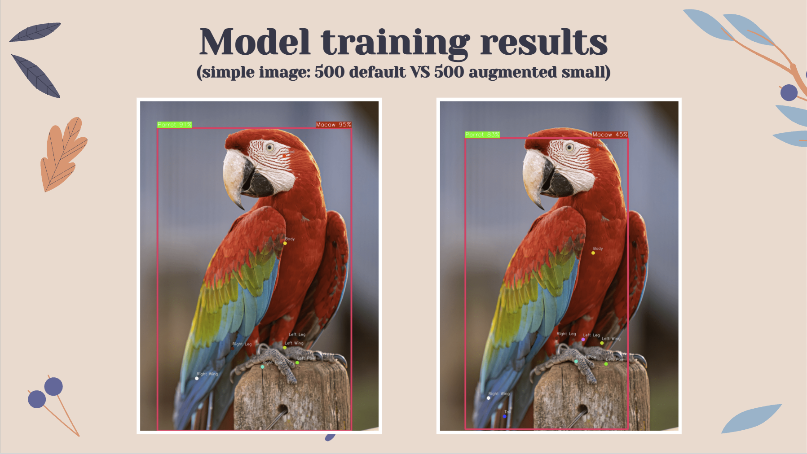

# Parrot-Species-and-Keypoints-Detection

- A computer vision system built to detect parrots in videos, classify their species, detect anatomically relevant keypoints, and identify actions such as flying, eating, walking, and sitting.
- Created a custom dataset of 2,512 images covering 21 parrot species, which involved manual keypoint labeling and species assignment using Roboflow. The custom hierarchical dataset is publicly available on [Kaggle](https://www.kaggle.com/datasets/catalinaadelachirtes/parrot-hierarchical-detection-dataset).
- Trained and evaluated multiple YOLO11 object detection and segmentation models, utilizing the Albumentations library in Python to build a full pipeline for custom offline augmentations.
- Experimented with markerless pose estimation using the DeepLabCut framework, and calculated behavioral metrics such as net displacement, instant speed, and solidity to classify the parrots' behavior.

## Available documentation

[Project presentation](Parrot%20Detection%20-%20Computer%20Vision.pdf)
